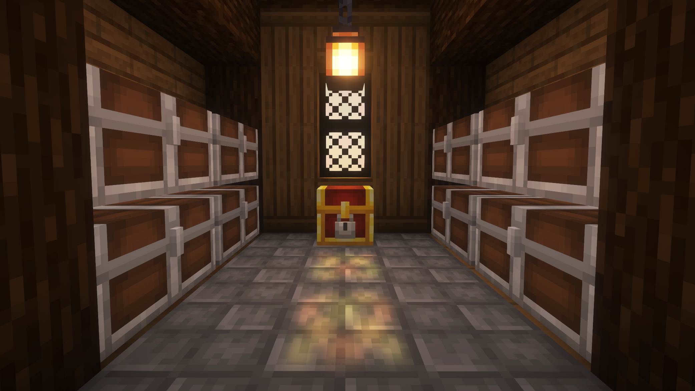
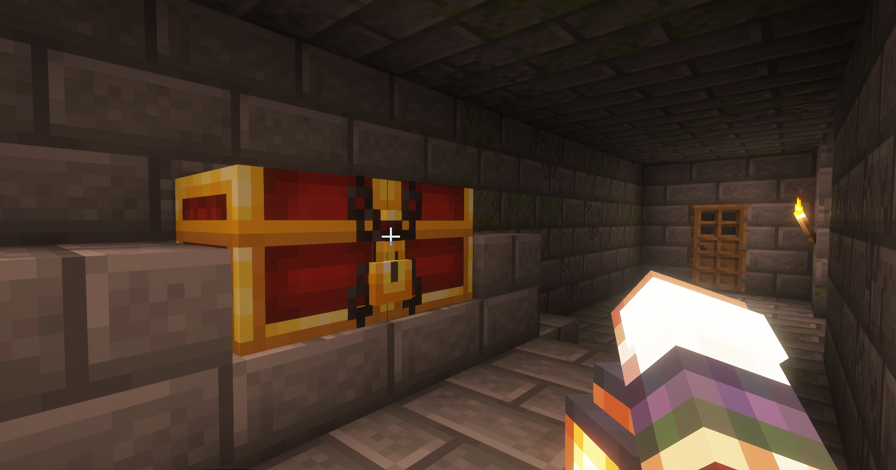
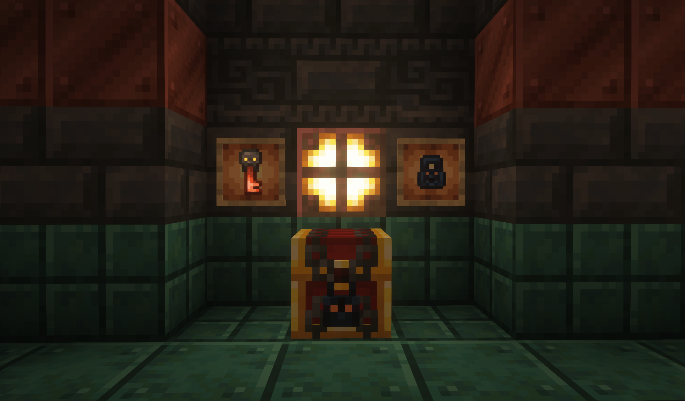
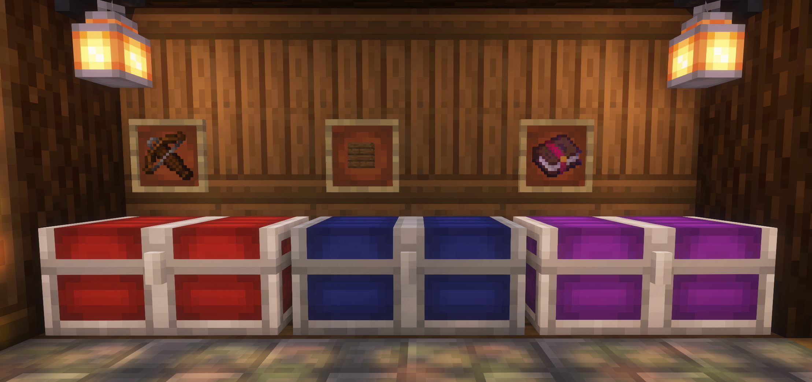

  

  <b>Lock it. Key it. Break into the good stuff.</b> 
  A NeoForge and Fabric mod that adds keys and locks for chests, barrels, doors and trapdoors, plus golden and trial locked treasure to hunt down.

  
  
  

---

## About

Lock your chests, barrels, doors and trapdoors with keys that only you and your friends carry. Out in the world, some treasure is locked too: Nether fortress chests can come with golden locks, and Dungeon Slimes carry the golden keys to open them.

---

## Keys and locks

Craft a **Key** and right-click a chest, barrel, door or trapdoor to lock it. Every key gets its own random 5-digit code, and only a key with the same code can open what it locked.

- **Shift-hover** a key to reveal its code.
- **Copy a key** in an anvil: key on the left, iron ingot on the right. You keep the original and get a copy to share.
- A matching key works from your **hand or anywhere in your inventory**.
- Locked containers can't be broken by other players. The owner, or anyone with the right key, still can.
- **Curios (NeoForge) or Accessories (NeoForge and Fabric), optional:** wear your key in a dedicated slot and it opens matching locks without being held.

### Golden locks
Some of the world's treasure is behind a **Golden Lock**. Open one with a **Golden Key**, which is used up when the lock opens.

- About **1 in 4 Nether fortress chests** generates with a golden lock, so bring a golden key.
- Golden and trial locked containers are **explosion proof**.

### Trial locks
**Trial Locks** are opened with vanilla **Trial Keys** from Trial Chambers. Trial keys show what they unlock in their tooltip.

### Doors and trapdoors
Lock **any door or trapdoor**, including iron, copper and modded ones, with a key, golden lock or trial lock.

- A **padlock is drawn on both sides** of a locked door and swings with it as it opens. (Trapdoors don't show a padlock yet.)
- A locked door stays shut against **redstone, villagers, zombies, pistons and wind charges** until it's opened with the right key.
- Locked doors can't be blown up or broken by other players, and neither can the block holding them up.
- A door's two halves share one lock, and a copper door keeps its lock as it weathers.
- Door locks and their padlocks are based on a contribution by **[Don Kevo](https://github.com/KevoMartinez256)**. Thank you!

---

## Dungeon Slime

A gray, see-through slime with a **golden key floating inside**. It is the main source of golden keys.

- Spawns in the Overworld **below Y 0** in full darkness, and commonly **inside strongholds**. Never on Peaceful, in mushroom fields or in the Deep Dark.
- Always spawns at medium size and drops **exactly one Golden Key**. Its small offspring drop slimeballs instead.
- Has its own spawn egg.

---

## Iron and Golden Chests

Two sturdier chests, each with a **trapped** version. Right-click one with **any dye** to recolor it.

- **Iron Chest:** natural wood trim until dyed.
- **Golden Chest:** a fabric trim that takes the dye color.
- Double chests keep each half's own color, even when you lock one half.

---

## Getting the items

| Item | How to get it |
| --- | --- |
| **Key** | Crafted: 1 iron ingot on top of 2 iron nuggets (vertical column) |
| **Key copy** | Anvil: key + iron ingot |
| **Golden Key** | Dropped by **Dungeon Slimes**, and sometimes found in **Nether fortress chests** (15%) |
| **Trial Key** | Vanilla: earned from Trial Spawners in Trial Chambers |
| **Iron Chest** | Crafted: a chest surrounded by 4 iron ingots (top, bottom, left, right) |
| **Golden Chest** | Crafted: a chest surrounded by 4 gold ingots (top, bottom, left, right) |
| **Trapped versions** | Crafted: the iron or golden chest + a tripwire hook |
| **Golden Lock / Trial Lock** | Creative menu only, for map makers and server admins |

Golden and trial keys stack to 16. Everything is in the **Locksmithing** creative tab.

---

## Compatibility

| | NeoForge | Fabric |
| --- | :---: | :---: |
| Keys, locks, doors, chests, Dungeon Slime | ✅ | ✅ |
| Worn key slot ([Curios](https://www.curseforge.com/minecraft/mc-mods/curios), optional) | ✅ | ❌ |
| Worn key slot ([Accessories](https://www.curseforge.com/minecraft/mc-mods/accessories), optional) | ✅ | ✅ |
| `fortressChestLockChance` config option | ✅ | Fixed at 25% |

- **Fabric** needs **[Fabric API](https://modrinth.com/mod/fabric-api)**.
- **Config (NeoForge):** set `fortressChestLockChance` between `0.0` and `1.0` to change how often fortress chests are golden locked. `0` turns it off.
- Locksmith is needed on **both the server and the client**.

---

## Links

- [Report a bug or suggest something](https://github.com/LuckyOwlStudios/luckys-locksmith/issues)
- [Changelog](https://github.com/LuckyOwlStudios/luckys-locksmith/blob/master/CHANGELOG.md)
