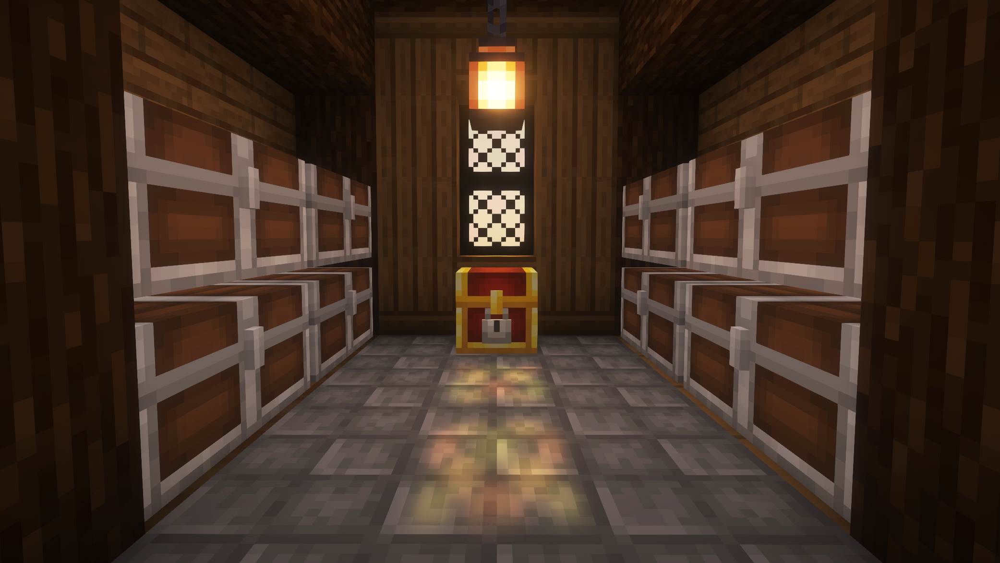
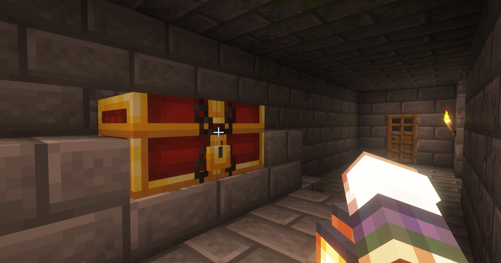
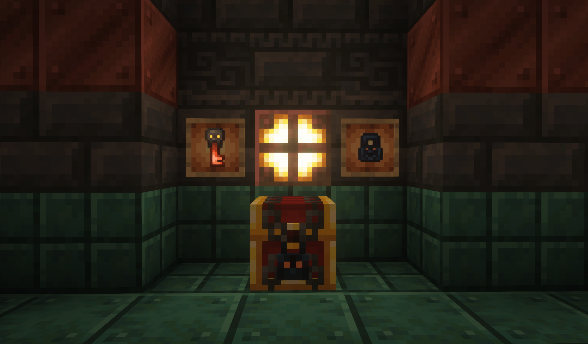
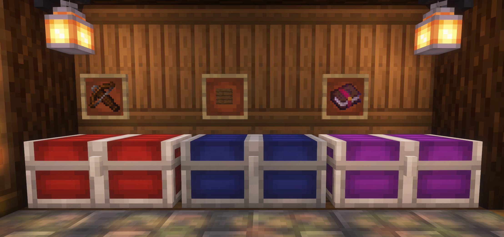
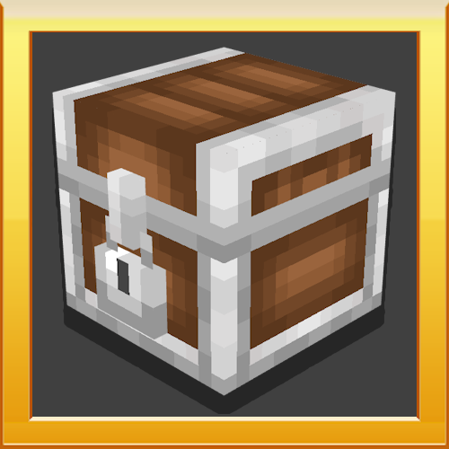

**Lock your chests and barrels with keys, and break into golden and trial locked chests found in the world.**

[Features](#-features) · [Getting the items](#-getting-the-items) · [Installation](#-installation) · [Compatibility](#-compatibility) · [Changelog](CHANGELOG.md)

---

## ✨ Features

### 🔑 Keys and locks
Craft a **Key** and right-click any chest or barrel to lock it. Every key gets its own random 5-digit code, and only a key with the same code can open what it locked.

- Hold <kbd>Shift</kbd> while hovering over a key to reveal its code.
- **Copy a key** in an anvil: key on the left, iron ingot on the right. You keep the original and get a copy to share with friends.
- A matching key works from your hand or anywhere in your inventory.
- Locked containers can't be broken by other players. The owner, or anyone carrying the right key, can still break them.

### 🟨 Golden locks
Some of the world's treasure is behind a **Golden Lock**. Open one with a **Golden Key**, which is used up when the lock opens.

- About **1 in 4 Nether fortress chests** generates with a golden lock, so bring a golden key with you.
- Containers with golden or trial locks are **explosion proof**, so no blowing your way in.

### 🟥 Trial locks
**Trial Locks** are opened with vanilla **Trial Keys** from Trial Chambers. Trial keys now also show what they unlock in their tooltip.

### 🟢 Dungeon Slime
A new gray, see-through slime that lurks **deep underground** with a golden key floating inside it.

- Spawns in the Overworld **below Y 0** in full darkness (never on Peaceful, in mushroom fields or in the Deep Dark).
- Always spawns at medium size and drops **exactly one Golden Key**. Its small offspring drop slimeballs instead.
- Has its own spawn egg for creative builders and map makers.

### 🧰 Iron and Golden Chests
Two sturdier chests, each with a **trapped** version:

- **Iron Chest** and **Iron Trapped Chest**
- **Golden Chest** and **Golden Trapped Chest**

Right-click them with **any dye** to recolor them and make your storage room match your style.

### 🚪 Doors and trapdoors
Locks work on **doors and trapdoors** too, including iron, copper and modded ones. Right-click one with a key, golden lock or trial lock, just like a chest.

- A padlock is drawn on both sides of a locked door and follows it as it swings. (Trapdoors don't show a padlock yet.)
- A locked door ignores redstone, villagers, zombies, pistons and wind charges until you open it with the right key.
- Locked doors can't be blown up or broken by other players, and neither can the block holding them up.
- Door locks are based on [KevoMartinez256's](https://github.com/KevoMartinez256) contribution. Thank you!

---

## 🧭 Getting the items

| Item | How to get it |
| --- | --- |
| **Key** | Crafted: 1 iron ingot on top of 2 iron nuggets (vertical column) |
| **Key copy** | Anvil: key + iron ingot |
| **Golden Key** | Dropped by **Dungeon Slimes**, and sometimes found in **Nether fortress chests** (15%) |
| **Trial Key** | Vanilla: earned from Trial Spawners in Trial Chambers |
| **Iron Chest** | Crafted: a chest surrounded by 4 iron ingots (top, bottom, left, right) |
| **Golden Chest** | Crafted: a chest surrounded by 4 gold ingots (top, bottom, left, right) |
| **Trapped versions** | Crafted: the iron or golden chest + a tripwire hook |
| **Golden Lock / Trial Lock** | Creative menu only, for map makers and server admins |

All of the mod's items are in the **Locksmithing** creative tab.

---

## 📦 Installation

1. Install **Minecraft 1.21.1** with either loader:
   - **NeoForge** 21.1.186 or newer, or
   - **Fabric Loader** 0.16.9 or newer, plus **[Fabric API](https://modrinth.com/mod/fabric-api)**
2. Drop the Locksmith jar for your loader into your `mods` folder.
3. Launch the game and start locking things up!

Locksmith is needed on **both the server and the client**.

---

## 🔌 Compatibility

| | NeoForge | Fabric |
| --- | :---: | :---: |
| Keys, locks, chests, Dungeon Slime | ✅ | ✅ |
| Worn key slot ([Curios](https://www.curseforge.com/minecraft/mc-mods/curios), optional) | ✅ | ❌ Not yet |
| `fortressChestLockChance` config option | ✅ | Fixed at 25% |

- **Curios (NeoForge, optional):** wear your key in a dedicated key slot and it opens matching locks without needing to be held. Locksmith runs fine without Curios.
- **Config (NeoForge):** set `fortressChestLockChance` between `0.0` and `1.0` to change how often fortress chests are golden locked. `0` turns it off.

---

## 📜 Changelog

See **[CHANGELOG.md](CHANGELOG.md)** for what's new in each version.

---

Made by **LuckyOwl** · All Rights Reserved

Door locks and their visible padlocks by **[Don Kevo](https://github.com/KevoMartinez256)**

